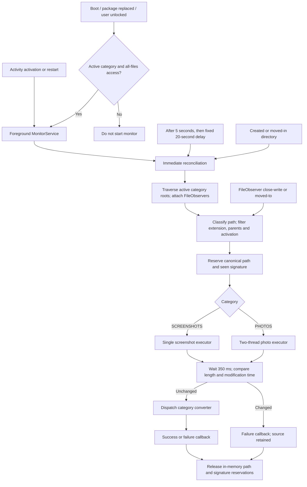
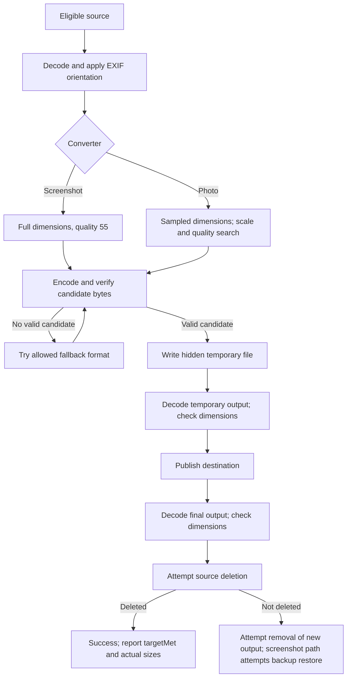
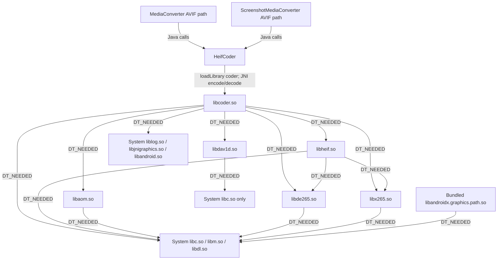

# Recovered architecture

This describes the inspected application bytecode, not a newly built or newly device-tested implementation. Readable [Java references](../sources/README.md) are decompiler output; the original Kotlin project is not recovered. Application ID: `id.eska.tidy`; implementation namespace: `id.eska.screenshotwebp`. The preserved APK is version `2.2.0` (version code 2), minSdk 30, targetSdk 33, with arm64-v8a native libraries only. See [recovery notes](RECOVERY-NOTES.md), [buildability roadmap](BUILD-FROM-SOURCE.md), and the [manifest](../resources/AndroidManifest.xml).

## Responsibilities and entry points

| Component | Observed responsibility |
| --- | --- |
| [MainActivity](../bytecode/id/eska/screenshotwebp/MainActivity.smali) | Compose/Material3 setup and dashboard, permission checks, category activation/format changes, state snapshots, monitoring restart, patched theme preference. |
| [AppStateStore](../bytecode/id/eska/screenshotwebp/AppStateStore.smali) / [AppState](../bytecode/id/eska/screenshotwebp/AppState.smali) | Synchronized preference access, legacy-state migration, category configuration and conversion counters/results/errors. |
| [CategoryConfig](../bytecode/id/eska/screenshotwebp/CategoryConfig.smali) | Active-path value object containing category, nullable activation epoch and selected output format; `active` is derived from whether activation is non-null. Passed from state snapshots to UI and queued monitoring work. |
| [BootReceiver](../bytecode/id/eska/screenshotwebp/BootReceiver.smali) | Starts monitoring on boot, package replacement, or user unlock when a category is active and all-files access is available. |
| [MonitorService](../bytecode/id/eska/screenshotwebp/MonitorService.smali) | Foreground notification and `MediaMonitor` lifecycle; records conversion outcomes and requests media rescans after successful conversion. |
| [MediaMonitor](../bytecode/id/eska/screenshotwebp/MediaMonitor.smali) | Directory observers, periodic reconciliation, eligibility/deduplication, executor queues, stability check and converter dispatch. |
| [PathPolicy](../bytecode/id/eska/screenshotwebp/PathPolicy.smali) | Canonical-path classification and hidden/technical-directory exclusions. |
| [ScreenshotMediaConverter](../bytecode/id/eska/screenshotwebp/ScreenshotMediaConverter.smali) | Full-resolution, fixed-quality screenshot-category conversion, output replacement/backup and publication. |
| [MediaConverter](../bytecode/id/eska/screenshotwebp/MediaConverter.smali) | Sampled photo decode, scale/quality candidate search, fallback and unique-name publication. |
| [MediaModelKt](../bytecode/id/eska/screenshotwebp/MediaModelKt.smali) | `fallbackFormat` selects the opposite AVIF/WebP format for the active photo converter. Its separate `screenshotFormat` helper always returns AVIF, but no caller is observed in the recovered app bytecode; it does not override the active screenshot converter's requested-format handling. |
| [TargetBucket](../bytecode/id/eska/screenshotwebp/TargetBucket.smali) | Active-path value object holding `maxBytes`, returned by `TargetPolicyKt.targetBucket` for photo candidate search and target reporting; not a queue, media category or enforced deletion rule. |
| [CompressionPlanKt](../bytecode/id/eska/screenshotwebp/CompressionPlanKt.smali), [TargetPolicyKt](../bytecode/id/eska/screenshotwebp/TargetPolicyKt.smali), [ConversionResult](../bytecode/id/eska/screenshotwebp/ConversionResult.smali) | Compression parameters, byte targets, and conversion status/size/dimension/path/format/fallback/target-met results. |
| [ScreenshotMonitor](../bytecode/id/eska/screenshotwebp/ScreenshotMonitor.smali) | Retained older screenshot-only directory observer/reconciler and scheduled processor rooted at shared storage's `DCIM/Screenshots`; takes an activation epoch and invokes `ScreenshotConverter`, rather than the active category-aware converter pair. |
| [ScreenshotConverter](../bytecode/id/eska/screenshotwebp/ScreenshotConverter.smali) | Retained older source/destination conversion entry point used inside `ScreenshotMonitor`; not the `ScreenshotMediaConverter` constructed by the active foreground service. |

`ScreenshotMonitor` and `ScreenshotConverter` are retained recovery evidence, not the monitor/converter pair constructed by `MonitorService.onStartCommand`. That service constructs `MediaMonitor`, `MediaConverter` and `ScreenshotMediaConverter`. Their older pipeline and the uncalled `MediaModelKt.screenshotFormat` helper must not be substituted for the active service flow described below.

The manifest declares notification, all-files, foreground-service, boot and battery-optimization permissions; it does not declare Internet access. The service is non-exported and uses the `dataSync` foreground-service type. `BootReceiver` is direct-boot-aware, but this is not a guarantee that shared storage or foreground-service startup is available in every boot/OEM state.

## Media discovery and queue flow

The category named **SCREENSHOTS is broader than a screenshot folder**:

- Eligible extensions are case-insensitive JPG, JPEG and PNG; existing AVIF/WebP outputs are not input candidates.
- Canonical descendants of shared storage's `DCIM/Camera` are PHOTOS.
- Other eligible canonical descendants of shared storage are SCREENSHOTS, not just `DCIM/Screenshots`. Non-camera downloaded or messaging-app images can therefore enter the screenshot pipeline.
- Hidden files/parents and technical parents such as Android, thumbnails, cache and caches are excluded.
- Photo monitoring traverses the camera tree. Screenshot reconciliation traverses shared storage, excluding the camera tree and hidden/technical directories.
- A category must have an activation value. Photos additionally require modification time, in whole epoch seconds, **strictly newer** than activation. Screenshot eligibility deliberately bypasses the activation-age test, so pre-existing eligible non-camera images can be processed.

`MediaMonitor.start` reconciles immediately, then schedules with an initial five-second delay and a twenty-second fixed delay. Completed-file events are `CLOSE_WRITE`/`MOVED_TO` (mask `0x88`); directory creation/move-in triggers reconciliation.

The deduplication signature includes category, canonical path, modification seconds, file length and requested format. A separate canonical-path reservation prevents concurrent processing of the same path. Both reservations are removed when processing ends, including exceptional exits: this is **in-flight deduplication, not a durable processed-file ledger**. Retained inputs can be reconsidered on later scans. The active `process` body performs one stability check and one conversion dispatch; the retained `MAX_RETRIES` constant does not establish an implemented retry loop. Queues and reservations are in memory, not a persistent database or WorkManager job store.

Screenshot bursts are serial; the entire app is not serial because photos use two workers. Queued work captures the configuration used at enqueue time; changing a preference is not evidence that already queued jobs are cancelled or rewritten.

## Conversion and fallback

### Screenshot-category path

`ScreenshotMediaConverter.convert` decodes with `BitmapFactory.decodeFile` without the photo sampling options, applies EXIF orientation, and encodes the oriented dimensions at quality **55**. Requested AVIF attempts AVIF first and then WebP if encoding, verification or publication fails. Requested WebP has only a WebP attempt. It does not downscale or search quality to meet a size limit.

The **102,400-byte (100 KiB) target is reported, not enforced as a deletion gate**. A valid published screenshot output can succeed and replace the original even when it exceeds that target or is larger than its source.

### Photo path

`MediaConverter.decodeSource` reads bounds, selects a power-of-two sample factor with a nominal maximum dimension of **2,560**, and decodes ARGB_8888 before orientation correction. This is a memory-reduction strategy for large photos, not a promise to retain a 48-megapixel image at original resolution.

The active candidate search uses scales **1.0, 0.75, 0.5, 0.25** relative to the sampled/oriented bitmap. At each scale it verifies a quality-20 encoding. If that fits the target, it tries quality 85, then binary-searches qualities 21–84 for a fitting verified candidate. If no scale fits, the first valid quality-20 candidate can still be returned above target. The separately recovered `initialQualityCandidates` helper (85/55/25) is not the search implemented by `findCandidate`.

Fallback is used only when no valid candidate is returned for the requested format, **not merely when the target is missed**. The photo helper switches to the other format: AVIF → WebP and WebP → AVIF. This differs from the screenshot path's one-way AVIF → WebP policy.

| Original photo byte count | Target byte count |
| --- | ---: |
| More than 3,145,728 (3 MiB) | 768,000 (750 KiB) |
| More than 1,048,576 up to 3,145,728 | 512,000 (500 KiB) |
| More than 512,000 up to 1,048,576 | 256,000 (250 KiB) |
| At most 512,000 | 102,400 (100 KiB) |

These are policy thresholds from `TargetPolicyKt.targetBucket`, not measured storage-saving percentages or guaranteed maximum output sizes.

The fallback arrow represents a bounded format attempt sequence, not unlimited retries. Failures before successful source deletion retain the source; publication/rollback details differ below.

## Orientation, publication and deletion limits

Both converters read EXIF `Orientation` using AndroidX ExifInterface and transform bitmap pixels for orientations 2–8, including mirror/rotation combinations. Unreadable orientation defaults to normal; a failed bitmap transformation falls back to the untransformed bitmap. Thus orientation handling exists, but a failed transform is not a hard failure preventing deletion.

The inspected app code does **not copy general EXIF metadata** into outputs. Do not promise preservation of GPS, capture timestamps, camera tags, thumbnails or color/HDR metadata merely because orientation is handled.

- **Photos:** choose a same-directory name with the selected extension, adding ` (n)` for existing names; write a hidden UUID `.tmp`; verify it; publish with `File.renameTo`; verify the final file; only then call source `delete`. If source deletion fails, attempt to delete the new output and return failure.
- **Screenshots:** use the same basename with the output extension. An existing destination is moved to a hidden UUID `.bak` before replacement. Temporary and final files are verified; source deletion follows final verification. On failure the code attempts removal/restoration; on success the old-output backup is deleted. This can replace an existing same-basename output, unlike the photo unique-name path.
- The screenshot move helper requests `ATOMIC_MOVE`, with an existence-check/`renameTo` fallback. Despite its name `moveWithoutReplacement`, this is not proof of portable race-free no-overwrite semantics. The photo destination existence check and rename are also not a transactional reservation.
- Verification decodes bytes (native AVIF decoder or Android BitmapFactory for WebP) and checks exact expected width/height. It is not a source-pixel comparison, metadata audit, perceptual-quality check, checksum comparison or size-saving requirement.
- The monitor's 350 ms length/mtime check does not lock the source against changes during encoding/deletion. Publication and source deletion are separate filesystem operations. No crash journal, fsync durability guarantee, trash/undo mechanism or reliable rollback across process death is established by these methods; several cleanup/restore return values are ignored.

This is a **verify-before-delete sequence with important limits**, not an unconditional guarantee of lossless or recoverable replacement. Use copies of expendable media for future acceptance testing.

## State and presentation

`AppStateStore` uses device-protected SharedPreferences named `state`, not Room or another database. Category keys cover activation/baseline, selected format, successful count, saved bytes, last result and last error (`screenshot_*` and `photo_*`). AVIF defaults and legacy migration are present; legacy key names marked deprecated remain recovery evidence, not new API recommendations.

Success increments the category count, adds `max(sourceBytes - outputBytes, 0)` to saved bytes, records actual format/sizes and target-miss text, clears that category's error and updates a shared fallback counter when applicable. Consequently the displayed saved-byte total cannot reveal output growth or replacement of an existing screenshot output. It is an accounting value, not a fresh scan of available disk space. Failures record the source filename and message. `AppState` snapshots expose category configuration and accumulated results; there is no observed live queue-depth/progress field. See [UI design and observed differences](UI-DESIGN.md).

## Native boundary and unresolved provenance

AVIF encode/decode uses `com.radzivon.bartoshyk.avif.coder.HeifCoder`, lazily created by the converters. The inspected wrapper loads **`coder`** with `System.loadLibrary` and forwards to JNI methods such as `encodeAvifImpl` and `decodeImpl`. The app requests lossy AVIF with speed SEVEN and automatic surface/chroma options. WebP encoding uses Android Bitmap compression, not a newly recovered native implementation.

The APK contains `libcoder.so`, `libheif.so`, `libaom.so`, `libdav1d.so`, `libde265.so`, `libx265.so` and `libandroidx.graphics.path.so` for arm64-v8a. Wrapper HEIC methods and bundled HEVC libraries do **not** mean the app exposes HEIC conversion: its output model contains AVIF and WebP only.

The dependency graph below separates observed Java/JNI calls from **ELF `DT_NEEDED`** edges inspected with `readelf -d` on the extracted arm64 libraries. Dependency arrows establish dynamic linkage, not which codec executes for a particular image or the absence of statically embedded components.

In particular, the inspected `libheif.so` lists `libx265.so` and `libde265.so`, but does not list `libaom.so` or `libdav1d.so` as dynamic dependencies; the latter are direct `libcoder.so` dependencies in this binary. `libandroidx.graphics.path.so` is a separately bundled library, not an observed dependency of the codec chain. Android system libraries in the diagram are dependencies, not additional recovered app source. See [third-party notices](THIRD-PARTY-NOTICES.md) for the associated provenance/licensing record.

Native library names and Java/JNI declarations do not recover C/C++ source, exact revisions, build flags or all license obligations. Consult [third-party notices](THIRD-PARTY-NOTICES.md). Exact native corresponding source and license provenance are prerequisites for a complete source-build/release claim; this recovery alone does not clear that gate.
