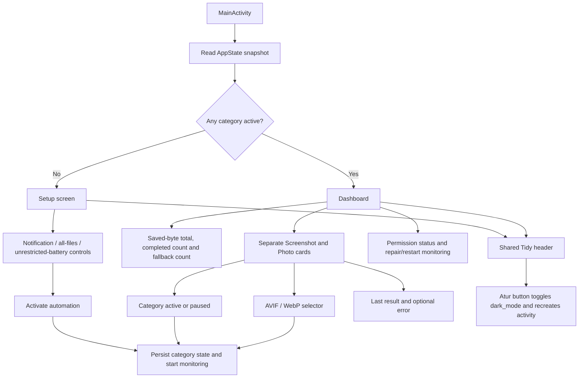

# UI design: intention and recovered implementation

This document separates the earlier dashboard design intention from static evidence in the recovered version `2.2.0` UI-dark arm64 r3 APK. It is not a report of a new launch, screenshot comparison, accessibility audit or device conversion test. The application ID is `id.eska.tidy`; its Compose implementation remains in `id.eska.screenshotwebp`.

Primary local evidence: [MainActivity bytecode](../bytecode/id/eska/screenshotwebp/MainActivity.smali), [button-label composables](../bytecode/id/eska/screenshotwebp/ComposableSingletons$MainActivityKt.smali), [AppState](../bytecode/id/eska/screenshotwebp/AppState.smali), [state store](../bytecode/id/eska/screenshotwebp/AppStateStore.smali), [extracted resources](../resources/res/) and [manifest](../resources/AndroidManifest.xml). Read [architecture](ARCHITECTURE.md) for actual media behavior and [recovery notes](RECOVERY-NOTES.md) for provenance.

## Earlier design intention

The recovery workspace's `2026-08-16-tidy-dashboard-ui-design.md` specified a UI/theme/icon-only refresh, retaining conversion behavior:

- A dark navy dashboard, rounded cards/chips, accessible contrast and blue-purple accents from the supplied Tidy icon.
- Header branding, subtitle, monitoring status and service controls.
- Real successful-conversion and saved-byte totals, separate Screenshot and Photo cards, independently visible AVIF/WebP selections, category settings and last result/error.
- Queue/progress information only where exposed by existing state; no invented activity or savings values.
- A persisted theme choice labelled **“Always dark”** (`Selalu gelap`) or **“Follow system”** (`Ikuti sistem`), defaulting to dark.
- An adaptive foreground mark on a light background, legacy launcher icon resources and the complete supplied image as an in-app logo; density-appropriate resources rather than loading a large source image during rendering.
- No new encoder formats, converter/fallback/EXIF/deletion changes, database, background worker, network permission, dependency or automatic-reprocessing policy.

These are design requirements, not proof that every requirement was implemented. The original design document's proposed smoke tests and static regression checks are also not newly exercised verification.

## Observed UI structure

The recovered implementation uses Jetpack Compose and Material3, including lazy lists, cards, category switches, output-format selectors and permission buttons. Its visible strings are largely Indonesian; the English descriptions below are explanatory, not claims of an English-localized APK.

The screen branch reads `AppState.getAnyActive()`: with no active category it selects setup; otherwise it selects the dashboard. This is not a direct check that the foreground service is running.

| Area | Static evidence and limits |
| --- | --- |
| Header | Text “Tidy” and a subtitle meaning “Screenshots and photos, organized automatically.” A header button is wired to the patched theme callback. |
| Setup | Notification, all-files access and unrestricted-battery setting controls, plus activation of automation. These are OS settings/permission affordances, not proof that an OEM will keep the service alive. |
| Summary | State-derived saved bytes, successful count and fallback count. No fixed storage-saving percentages are supported. |
| Category cards | Separate Screenshot/Photo labels, active/paused switch, format choice, successful count, saved bytes, last result and optional error. Format keys remain `screenshot_format` and `photo_format`. |
| Service/permissions | Notification/file/battery status text and a repair/restart action. Readiness/category activation should not be presented as measured background-service health. |
| Queue/progress | `MediaMonitor` has in-memory executor queues, but the inspected `AppState` snapshot/UI does not expose a live queue-depth or per-file progress field. The intended activity/queue card must not be documented as implemented merely because work is queued internally. |

The category name “Screenshot” is a UI label, not a reliable description of every file processed: the current path policy includes eligible non-camera images throughout shared storage, and screenshot-category processing can include older files. Photo sampling can reduce resolution. Both facts matter when writing explanatory UI text; see [conversion behavior and safety limits](ARCHITECTURE.md).

## Theme: the important divergence

The final bytecode implements a **boolean override**, not the intended two-option “Always dark / Follow system” model:

1. `isDarkMode()` reads ordinary activity SharedPreferences named `tidy_ui`, key `dark_mode`, default **true**. This is separate from the device-protected conversion-state preferences named `state`.
2. When true, `onCreate`'s composable uses `createDarkColorScheme()`.
3. When false, it passes no explicit color scheme and uses the Material3 default/inherited scheme path. No system-dark-theme query is observed in this branch. Do not label it “Follow system” based solely on this code.
4. The header's outlined button uses the existing text **`Atur`** (“Set/Configure”), not the spec's named theme options. Its synthetic callback calls `toggleDarkMode()`.
5. Toggling negates the preference, calls `apply()`, then `Activity.recreate()`.

This establishes the persisted implementation path, not a newly observed relaunch-persistence result. It also does not establish which colors every device actually displays on the non-dark branch. A future source UI should make the actual theme modes explicit rather than silently promising system-theme behavior.

## Icons and logo

The manifest uses `@mipmap/ic_launcher` and `@mipmap/ic_launcher_round`. The extracted [adaptive icon](../resources/res/mipmap-anydpi/ic_launcher.xml) references `@color/tidy_icon_background` and `@drawable/tidy_icon_foreground`; [round adaptive icon](../resources/res/mipmap-anydpi/ic_launcher_round.xml) and density-specific legacy PNG resources are also retained.

The supplied-image treatment was an intention. In the inspected `Header` implementation, branding is text; no in-app image-rendering call for the complete supplied logo was found. The presence of a launcher foreground PNG is not evidence of the complete in-app logo requirement. Actual icon appearance/cropping and visual parity with the supplied image require a future rendering/device review.

## Data honesty and behavioral boundaries

- Display only actual state values. Initial successful counts and saved bytes are zero; the last-result empty state means no conversion yet, not a fabricated demonstration result.
- Saved-byte accounting adds `max(sourceBytes - outputBytes, 0)` per success. It does not report free disk space, subtract growth from larger outputs, or account for replacement of an existing same-basename screenshot output.
- A selected AVIF format is a request, not a guarantee of AVIF output. Screenshot AVIF has WebP fallback; photos can fall back in either direction when no valid candidate exists.
- “Target not met” is compatible with successful conversion. Neither the screenshot target nor the photo bucket is a general output-size/deletion guarantee.
- Orientation transformation is present, but complete EXIF preservation, losslessness and recoverable deletion are not established. Do not replace the architecture's safety caveats with a UI-only assurance.
- No new runtime behavior has been introduced by this documentation recovery. The earlier spec's restriction to UI changes does not itself prove a byte-for-byte regression comparison against every prior APK.

## Future acceptance work, not completed checks

Before claiming a rebuilt UI meets the intention, verify on a compatible arm64 Android device: first-run permissions and setup/dashboard transitions; explicit theme semantics and persistence after relaunch; independent category formats/activation; real totals/result/error rendering; adaptive/legacy icon appearance; contrast, text scaling and touch targets. Conversion regression work must use expendable copies and cover burst ordering, non-camera path scope, large-photo resolution, fallback, orientation, metadata loss and deletion/rollback behavior. Preserve the [original release identity](../releases/v2.2.0/RELEASE-NOTES.md); a future source build is a separate artifact, not a newly verified replacement for it.
